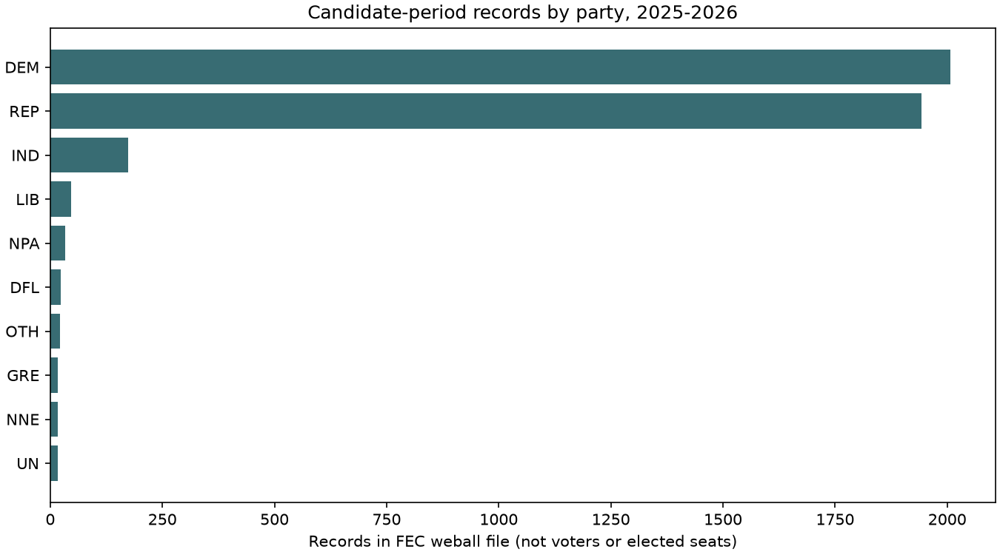
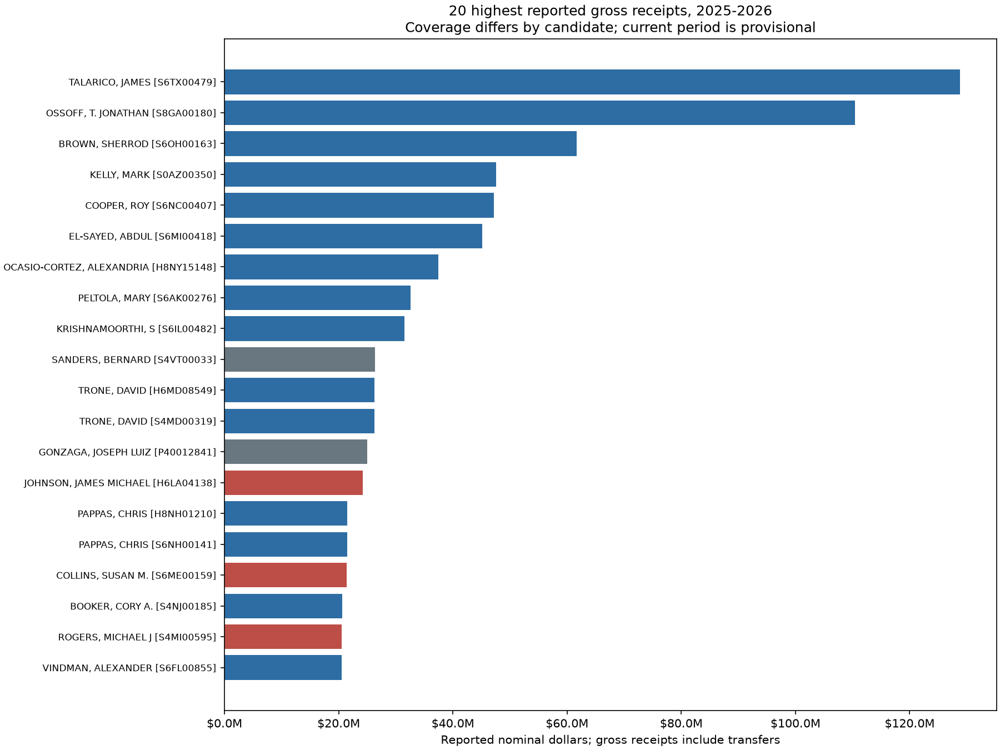
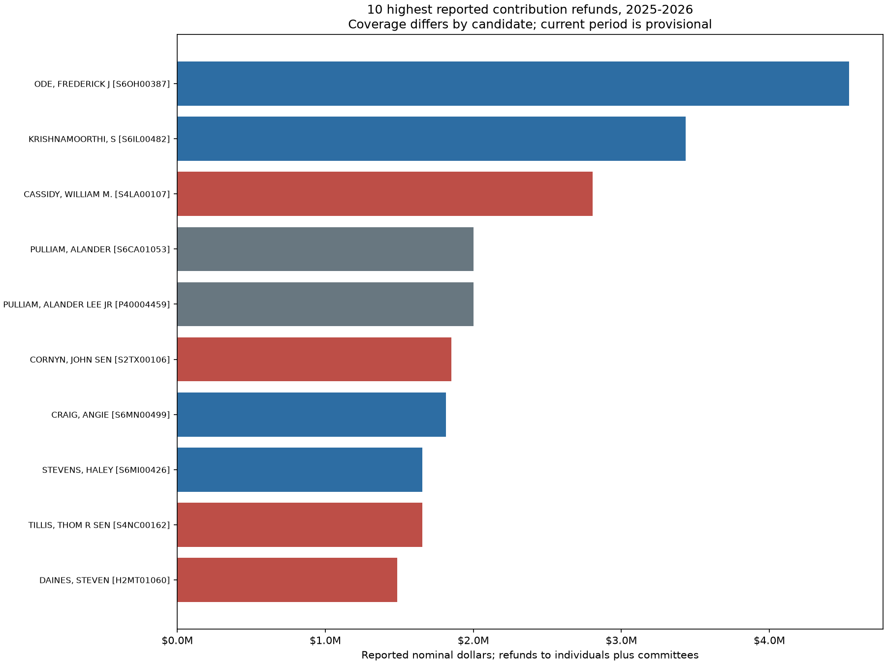

# Campaign Finance Analytics

Exploratory analysis of FEC **all-candidates (weball) files** for 14 two-year reporting periods, **1999–2000 through 2025–2026**. The project began in 2025; this October 19, 2026 revision corrects the financial-field mapping and makes the analysis reproducible.

## What this analysis does

- Loads named fields from the [official 30-column FEC schema](https://www.fec.gov/campaign-finance-data/all-candidates-file-description/), retaining candidate IDs, reporting period, party and coverage dates.
- Validates row width, duplicate IDs within a file, numeric values and dates. Missing amounts remain unknown rather than silently becoming zero.
- Separates **44,890 candidate-period records** from **20,841 distinct FEC candidate IDs** in the downloaded snapshot. IDs recur across periods and may change party; IDs are not a validated count of unique people.
- Produces party counts by period, latest-period gross-receipt and refund summaries, charts and CSV exports.
- Saves source URLs, download timestamps, input hashes and quality findings in [results/validation.json](results/validation.json).

## Corrections and limits

The earlier notebook called zero-based field 6 “Total_Donations.” That field is **transfers from authorized committees**, not donations. **Total receipts is position 6 / zero-based field 5**. The corrected analysis uses TTL_RECEIPTS and labels it **reported gross receipts**. TRANS_FROM_AUTH remains separate; gross receipts can include committee transfers and double-counted financial activity. Gross receipts are not donations, unique donor money or net receipts.

File weball26 represents the **2025–2026 reporting period**, not a complete standalone 2025 year. Current-period figures are provisional, and individual coverage dates differ. The downloaded files contain implausible future coverage dates, including a historical record dated 2090. Those values are retained and flagged; missing/future coverage dates are excluded from latest-period financial rankings.

Party counts measure candidate-period records, not voters, elected representatives or unique people. Rankings compare records **within the latest reporting period**, not decades of unadjusted dollar amounts. There are no claims of causal effects, fraud, inflation-adjusted trends, or an implemented PandasAI interface.

## Reproduce

Use Python 3.12 or later from the repository root:

```bash
python -m venv .venv
source .venv/bin/activate
python -m pip install -r requirements.txt
python fec_analysis.py --download
python -m unittest -v test_fec_analysis.py
```

The download flag fetches the public FEC ZIP files and caches text files plus provenance under ignored data/. Cached files must match their recorded hashes. To rerun saved inputs without network access:

```bash
python fec_analysis.py
```

To refresh upstream data deliberately, use a new cache/output directory and keep the old hashes:

```bash
python fec_analysis.py --download --data-dir data-refresh --out results-refresh
```

The [notebook](Political_Campaign_Fund_Analysis%201999-2025.ipynb) uses this module and these inputs. Its historical filename is retained for link compatibility; the title and period labels are corrected. Install nbformat, nbclient and ipykernel to execute it in Jupyter. The full merged table is generated locally and excluded from Git; compact summaries, validation and figures are included.

## Corrected results







CSV tables:
- [Party counts by period](results/party_counts_by_period.csv)
- [Distinct candidate IDs by party](results/distinct_candidate_ids_by_party.csv)
- [Latest-period top 20 reported gross receipts](results/latest_period_top20_gross_receipts.csv)
- [Latest-period top 10 reported refunds](results/latest_period_top10_refunds.csv)

The earlier Tableau workbook is a historical artifact and **has not been refreshed or validated against this corrected pipeline**. It is not the source of these results and should not support current quantitative claims. The original notebook and README remain recoverable through Git history.

## Tests

Regression tests distinguish receipts from transfers, preserve missing refunds, reject corrupt numeric fields and schema drift, reject duplicate IDs within a period, flag future coverage dates, and distinguish repeated candidate IDs across periods. They validate the pipeline, not every underlying campaign filing.

Data: [FEC bulk data](https://www.fec.gov/data/browse-data/?tab=bulk-data). Methodology: [FEC all-candidates file description](https://www.fec.gov/campaign-finance-data/all-candidates-file-description/).


